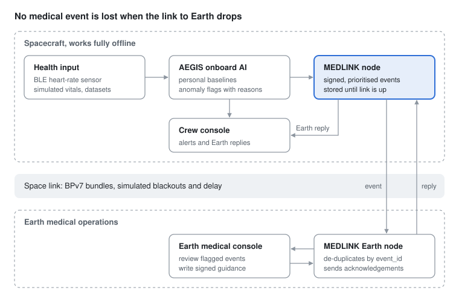
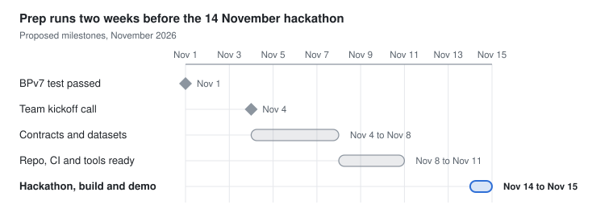

# AEGIS-MEDLINK — Background & Technical Plan

Team Against the Silence · NASA Space Apps 2026 · Nov 1, 2026 · Asasira Martin

> ✏️ This page is the team's living plan. To change it, open [`docs/index.md`](https://github.com/OWNER/aegis-medlink/edit/main/docs/index.md) on GitHub, edit, and commit.

## Background

On long missions, astronauts must spot health problems themselves, often when Earth cannot answer quickly or at all.

Our challenge, **Create Health Monitoring Software for Astronauts on Space Missions**, asks for software that gathers health indicators and lets astronauts evaluate and act on their health. NASA names the risks: radiation, isolation and confinement, altered gravity and a closed environment, leading to immune changes, bone loss, cardiovascular events and behavioural health problems.

Connectivity makes this harder. A one-way signal between Earth and Mars takes roughly 4 to 24 minutes (approximate, depends on planet positions), and links drop during blackouts and contact gaps. A monitoring app that needs the cloud, or loses messages when the link drops, fails exactly when it matters.

**Problem statement:** How can an astronaut health system keep giving useful decision support onboard, and keep medical information flowing reliably to and from Earth, when the link is delayed, interrupted or limited?

## What we are building

AEGIS-MEDLINK is two parts that share one message format: AEGIS thinks onboard, MEDLINK carries messages to and from Earth.

- **AEGIS (onboard health intelligence):** reads vitals, learns each astronaut's personal baseline, flags unusual trends with a plain-language reason, and shows approved guidance. Runs fully offline on a normal CPU.
- **MEDLINK (delay-tolerant medical link):** turns flagged events into prioritised, signed messages, stores them safely, and delivers them over BPv7 (NASA's delay-tolerant Bundle Protocol) whenever a link is available. Earth replies travel back the same way.
- **Two consoles:** a spacecraft console for the crew and an Earth medical console for the simulated flight-surgeon team.

**What we will not claim:** that the prototype diagnoses anything, that it is flight-ready, or that we solved spacecraft connectivity. We build on NASA's existing delay-tolerant networking (DTN) work, use public or clearly labelled synthetic data, and keep humans in charge of medical decisions.

## System flow



1. Vitals come in from the BLE sensor or the simulator.
2. AEGIS compares them with the astronaut's baseline and flags anything unusual, with a reason, on the crew console.
3. MEDLINK signs the event, sets its priority and hands it to the BPv7 node, which keeps it on disk until a link is up.
4. Earth's node receives it, drops duplicates and acknowledges it; the medical console shows it for review.
5. The reviewer's signed guidance travels back the same way and appears on the crew console.

## Technology stack

Everything runs on laptops with Docker; no GPU and no cloud service is needed for the demo.

| Component | Technologies | Why |
| --- | --- | --- |
| Health input | BLE heart-rate sensor, Python `bleak`, simulator for other vitals, public datasets | One real sensor proves the path; simulation covers vitals we can't measure |
| AEGIS (onboard AI) | Python, FastAPI, pandas, scikit-learn (rolling baselines, z-scores, Isolation Forest) | Fast on CPU, explainable, easy to test |
| Explanations (optional) | Small local LLM via Ollama, limited to approved text | Plain-language summaries without cloud; never prescribes |
| Local storage | SQLite (events, vitals, audit log) | One file, survives restarts |
| MEDLINK | Python FastAPI service + dtn7-rs BPv7 daemon (`dtnd`) over its local HTTP API | Real BPv7 bundles, store-and-forward, persistent bundle store |
| Link simulator | Docker network + Linux `tc netem` (delay, loss), scheduled link windows | Repeatable blackouts and delays on stage |
| Spacecraft console + Earth console | Next.js (React, TypeScript), Tailwind, Recharts | Two clear screens for the judges |
| Shared contracts | JSON Schema for events, OpenAPI for each service | Lets everyone build in parallel against mocks |
| Security | Ed25519 message signing, encryption at rest for stored events | Earth can trust who sent what |
| Delivery | GitHub, GitHub Actions, Docker Compose | One command starts the whole demo |

## BPv7 feasibility result

BPv7 works for MEDLINK: on 1 Nov 2026 all four tests passed with two real BPv7 nodes, so we use the real protocol, not fake delays over HTTP.

Setup: two [dtn7-rs](https://github.com/dtn7/dtn7-rs) 0.21.0 daemons in Docker, `dtn://spacecraft` and `dtn://earth`, TCP link between them, persistent bundle store (sled). Test payloads were sample JSON medical events.

| Test | What we did | Result |
| --- | --- | --- |
| A. Normal delivery | Send one event, link up | Delivered in about 1 s |
| B. Blackout | Cut the link, send, wait 8 s, restore | Held on spacecraft, delivered about 6 s after restore |
| C. Restart during blackout | Cut link, send, kill and restart spacecraft node, restore | Bundle survived on disk, delivered after restore |
| D. Added latency | 3 s one-way delay with `tc netem` | Delivered in about 4 s |

**What this means for the build:**

- The node needs peer IP addresses, not hostnames (hostnames crashed the first run), so the Compose file pins IPs.
- TCP will not survive a real 12-minute delay. For the demo we compress time and model link windows; we name LTP (the protocol real deep-space DTN uses) as future work.
- A bundle can arrive more than once, so Earth de-duplicates by `event_id` and sends its own signed acknowledgement back.
- NASA's own implementation, [HDTN](https://github.com/nasa/HDTN), is a later option if we want to show interoperability.

## Repository and collaboration

One GitHub organisation with one main repository (a monorepo): each part gets its own folder and owner, not its own repo.

Why one repo: with three people and 48 hours, separate backend and frontend repos mean extra setup, version drift and harder integration. One repo gives one CI pipeline, one `docker compose up`, and contract changes that land in the same pull request as the code that uses them.

```text
aegis-medlink/
├── contracts/          # JSON Schemas + OpenAPI (shared, reviewed by all)
├── services/
│   ├── aegis/          # onboard AI (Python)
│   ├── medlink/        # BPv7 gateway (Python + dtnd)
│   └── simulator/      # sensors, link outages, delays
├── apps/
│   ├── spacecraft/     # crew console (Next.js)
│   └── earth-console/  # medical console (Next.js)
├── tests/integration/
├── docs/
├── docker-compose.yml
└── .github/            # CI workflows, CODEOWNERS, PR template
```

**How we work:**

- Short branches named `owner/feature`, small pull requests, one review, merge to `main` often. `main` always runs.
- `CODEOWNERS` routes each folder's reviews to its owner; any change under `contracts/` needs everyone.
- Every pull request runs schema checks, Python tests, frontend build and a smoke test in GitHub Actions.
- Each service ships mock data from day one, so nobody waits on anybody.
- Before 14 November the repo holds only docs, contract drafts and learning notes; product code starts at the hackathon, in line with Space Apps guidance.

## Team roles and timeline

Each person owns one part end to end and builds against the shared contracts, so all three work in parallel from hour one.

| Person | Owns | Folders | Before 14 Nov |
| --- | --- | --- | --- |
| Asasira Martin | Architecture, MEDLINK, integration, CI | `contracts/`, `services/medlink/`, `.github/` | Contracts draft, BPv7 notes, repo setup |
| Nur Sima Akgül | AEGIS onboard AI | `services/aegis/` | Pick datasets, compare baseline and anomaly methods |
| Mariam Saied (to confirm) | Consoles and/or simulator | `apps/`, `services/simulator/` | Sketch both screens, learn Next.js basics if needed |

Open roles we would welcome: a biomedical or medicine student to check our health assumptions, and a designer for the consoles.



Dates after 1 November are proposals; we fix them at the kickoff call.

## Sources

- [dtn7-rs (BPv7 daemon)](https://github.com/dtn7/dtn7-rs)
- [NASA HDTN](https://github.com/nasa/HDTN)
