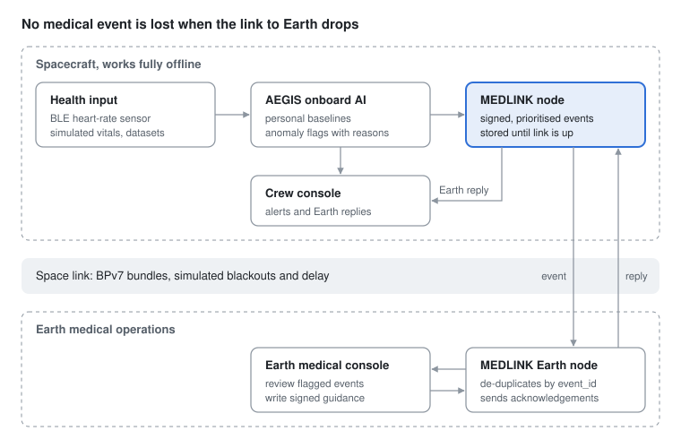

# AEGIS-MEDLINK — Arka Plan ve Teknik Plan

Against the Silence takımı · NASA Space Apps 2026 · 1 Kasım 2026 · Asasira Martin

> ✏️ Bu sayfa takımın yaşayan planıdır. Değiştirmek için [GitHub'da `docs/tr/index.md` dosyasını düzenleyin](https://github.com/Switch256/against-silence26/edit/main/docs/tr/index.md) ve kaydedin. Soru, fikir veya sorun için: [issue açın](https://github.com/Switch256/against-silence26/issues/new/choose).

## Hikâyemiz

<div class="story" markdown="1">

Bir astronot Dünya'dan milyonlarca kilometre uzakta. Sağlık ölçümleri olağandışı bir örüntü göstermeye başlıyor. Dünya ile iletişim kesiliyor.

**AEGIS** (*Astronaut Emergency Guidance and Intelligence System*) yerel olarak izlemeye devam eder, tıbbi bağlam raporu oluşturur ve **MEDLINK** bu bilgiyi korur.

Bağlantı geri geldiğinde, önceliklendirilmiş mesaj Dünya'ya ulaşır. Tıp ekibi olayı inceleyip yanıt gönderebilir.

<p class="story-tag">Care Beyond Connectivity.</p>

</div>

## Nasıl çalışır

Sağlık verileri simülatörümüzden (zaman kalırsa bir giyilebilir cihazdan) gelir. Uzay aracı bu verileri gemide kontrol eder. Bir sorun varsa Dünya'daki doktorlara bir mesaj gider; bağlantı kopuksa mesaj bekler ve asla kaybolmaz.



| | Parça | Tek cümleyle |
| --- | --- | --- |
| ⌚ | Sağlık verisi | NASA araştırmalarına göre şekillenen simülatör verileri; Bluetooth nabız sensörü isteğe bağlı bir artı |
| 🧠 | AEGIS | Uzay aracında: her astronotun normalini öğrenir ve normal olmayanı işaretler |
| 📨 | MEDLINK | Uyarıları PulseBrief'e dönüştürür, güvenle saklar, Dünya duyabildiğinde en acil olanı önce gönderir |
| 🌍 | İki panel | Web uygulamaları (PWA): gemideki astronot paneli ve doktorlar için Dünya konsolu |

## Arka plan

Uzun görevlerde astronotlar sağlık sorunlarını çoğu zaman kendileri fark etmek zorundadır; Dünya hızlı yanıt veremeyebilir ya da hiç veremeyebilir.

Seçtiğimiz görev, **Create Health Monitoring Software for Astronauts on Space Missions**, sağlık göstergelerini toplayan ve astronotların sağlıklarını değerlendirip harekete geçmelerini sağlayan bir yazılım istiyor. NASA riskleri şöyle sıralıyor: radyasyon, izolasyon ve kapalı ortam, değişen yerçekimi ve kapalı bir yaşam alanı; bunlar bağışıklık değişikliklerine, kemik kaybına, kalp-damar olaylarına ve davranışsal sağlık sorunlarına yol açabilir.

İletişim işi daha da zorlaştırır. Dünya ile Mars arasında tek yönlü sinyal yaklaşık 4 ila 24 dakika sürer (yaklaşık, gezegenlerin konumuna bağlı) ve bağlantı kesintiler ve iletişim boşlukları sırasında kopar. Buluta ihtiyaç duyan ya da bağlantı kopunca mesaj kaybeden bir izleme uygulaması, tam en çok gerektiği anda işe yaramaz.

**Problem:** Bir astronot sağlık sistemi, bağlantı gecikmeli, kesik veya kısıtlıyken gemide yararlı karar desteği vermeye ve tıbbi bilgiyi Dünya'ya güvenilir şekilde taşımaya nasıl devam edebilir?

## Ne inşa ediyoruz

AEGIS-MEDLINK, aynı mesaj formatını paylaşan iki parçadan oluşur: AEGIS gemide düşünür, MEDLINK mesajları Dünya'ya taşır ve geri getirir.

- **AEGIS, Astronaut Emergency Guidance and Intelligence System:** gemideki akıllı bileşen; fizyolojik verileri izler, anormallikleri tespit eder ve tıbbi uyarılar üretir. Hayati değerleri okur, bunları her astronotun kendi normaliyle basit kurallar ve istatistikle karşılaştırır (yapay zekâ modeli yok), olağandışı ölçümleri sade bir gerekçeyle işaretler ve onaylı yönergeleri gösterir. Normal bir işlemcide tamamen internetsiz çalışır.
- **MEDLINK (gecikmeye dayanıklı tıbbi bağlantı):** işaretlenen olayları öncelikli ve imzalı mesajlara dönüştürür, güvenle saklar ve bağlantı olduğunda BPv7 (NASA'nın gecikmeye dayanıklı Bundle Protocol'ü) ile iletir. Dünya'nın yanıtları aynı yoldan geri gelir.
- **İki konsol:** mürettebat için uzay aracı konsolu ve simüle edilmiş uçuş doktoru ekibi için Dünya tıbbi konsolu.

**İddia etmeyeceklerimiz:** prototipin teşhis koyduğunu, uçuşa hazır olduğunu ya da uzay aracı iletişim sorununu çözdüğümüzü. NASA'nın mevcut gecikmeye dayanıklı ağ (DTN) çalışmalarının üzerine inşa ediyoruz, herkese açık veya açıkça "simüle" etiketli veriler kullanıyoruz ve tıbbi kararları insanlara bırakıyoruz.

## Özel dokunuşumuz: PulseBrief

**Kopuk ve yavaş bir bağlantı için tasarlanmış bir sağlık mesajı.** Çoğu sağlık uygulaması ham sayılar gönderir: `heart_rate: 110` Dünya'ya ne olduğunu söyler ama önemli olup olmadığını söylemez. AEGIS bunun yerine bir **PulseBrief** gönderir: olayı açıklayan tek küçük bir mesaj; en önemli kısmı her zaman önce ulaşacak şekilde bölünmüş.

> *Sessizlik sırasında astronot asla yalnız değildir: AEGIS şimdi ne yapılacağını söyler, MEDLINK mesajı garanti eder, PulseBrief ise ilk 200 baytı değerli kılar.*

### 1. Üç katman, önce başlık

Her PulseBrief üç BPv7 paketi olarak gider. Bağlantı yalnızca birkaç saniyeliğine açılsa bile Dünya başlığı alır; geri kalanı bir sonraki pencerede gelir.

| Katman | İçeriği | Boyut (tahmini) | Gönderim |
| --- | --- | --- | --- |
| 🔴 Başlık | Kim, ne değişti, ne kadar acil, sinyal kalitesi | ~200 bayt | Her zaman ilk |
| 🟠 Bağlam | Uyku, egzersiz, oksijen, astronotun bildirimi | ~1 KB | Sonra |
| 🔵 Kanıt | Olaydan önceki ve sonraki ölçümler | birkaç KB | Yer olduğunda |

Karşılaştırma için: saniyede bir ölçümle 10 dakikalık ham veri yaklaşık 15–20 KB JSON eder. Bunlar tahmindir; gerçek sayıları hackathonda ölçeceğiz.

### 2. Astronot sessizlik içinde beklemeye bırakılmaz

- **Şimdi ne yapmalı:** AEGIS, doktorların önceden yazdığı kısa bir kontrol listesi gösterir (otur, 5 dakika sonra tekrar ölç, su iç). Yapay zekânın uydurduğu tavsiye değil.
- **3 dokunuşla bildirim:** "Nasıl hissediyorsun?" iyi / biraz kötü / kötü, artı bir belirti. Bu, mesajdaki "astronot diyor ki" satırı olur.
- **Yanıt geri sayımı:** sinyal gecikmesi ve bir sonraki bağlantı penceresinden hesaplanarak mürettebat ekranı, Dünya'nın mesajı ne zaman göreceğini ve yanıtın ne zaman gelebileceğini gösterir.

### 3. Daha az yanlış alarm

- **Önce sinyal kalitesi:** gevşek bir saat veya hareket ölçümleri zıplatır. AEGIS uyarmadan önce bunu kontrol eder ve her mesajı "sinyal: iyi / zayıf" olarak işaretler.
- **Aktiviteye duyarlı:** egzersiz sırasında hızlı nabız normaldir; dinlenirken değildir.

### Nasıl görünüyor



### Önce ne inşa ediyoruz

| Öncelik | Özellik | Kim |
| --- | --- | --- |
| Şart | Katmanlı PulseBrief: başlık, bağlam, kanıt | Martin |
| Şart | 3 dokunuşla bildirim ve "şimdi ne yapmalı" ekranı | Mariam (arayüz), Martin (mantık) |
| Şart | "Yanıt beklenen süre" geri sayımı | Mariam |
| Artı | Sinyal kalitesi kontrolü ve aktiviteye duyarlı uyarılar | Martin |
| Artı | Kısa pencere demosu: yalnızca başlık geçer | Martin, demoyu David yürütür |

**Sahnede kanıtlayacaklarımız:** başlık çok kısa bir bağlantı penceresinde bile Dünya'ya ulaşır, kesinti boyunca hiçbir şey kaybolmaz ve bir PulseBrief'in ham verilere göre kaç bayt gönderdiği.

**Veri hakkında:** NASA canlı astronot hayati verilerini yayımlamaz; tıbbi kayıtlar gizlidir. Gerçekçi aralıklar ve bağlam için NASA araştırmalarını ([Open Science Data Repository](https://osdr.nasa.gov/), [Human Research Program](https://www.nasa.gov/hrp/), [NASA Life Sciences Portal](https://www.nasa.gov/hrp/nlsp/)) ve açıkça "simüle" etiketli ölçümleri kullanıyoruz.

## Sistem akışı



1. Hayati değerler BLE sensöründen veya simülatörden gelir.
2. AEGIS bunları astronotun normaliyle karşılaştırır ve olağandışı her şeyi gerekçesiyle mürettebat konsolunda işaretler.
3. MEDLINK olayı imzalar, önceliğini belirler ve BPv7 düğümüne verir; düğüm bağlantı gelene kadar onu diskte saklar.
4. Dünya'daki düğüm mesajı alır, kopyaları atar ve alındı bildirir; tıbbi konsol mesajı incelemeye sunar.
5. İnceleyen doktorun imzalı yönergesi aynı yoldan geri gelir ve mürettebat konsolunda görünür.

## Teknoloji yığını

Her şey Docker ile dizüstü bilgisayarlarda çalışır; demo için GPU ya da bulut hizmeti gerekmez.

| Bileşen | Teknolojiler | Neden |
| --- | --- | --- |
| Sağlık verisi | Dahili simülatör (garanti), NASA'ya dayalı senaryo, isteğe bağlı BLE nabız sensörü (Python `bleak` veya Web Bluetooth) | Demo asla donanıma bağlı değil; gerçek bir sensör artı puan |
| AEGIS (sağlık verisi işleme) | Python, FastAPI, pandas (kayan ortalama tabanlı normaller, basit eşikler, z-skorları) | İşlemcide hızlı, açıklaması kolay, eğitilecek model yok |
| Yerel depolama | SQLite (olaylar, hayati değerler, denetim kaydı) | Tek dosya, yeniden başlatmalarda kaybolmaz |
| MEDLINK | Python FastAPI servisi + dtn7-rs BPv7 servisi (`dtnd`), yerel HTTP API'si üzerinden | Gerçek BPv7 paketleri, sakla-ve-ilet, kalıcı paket deposu |
| Bağlantı simülatörü | Docker ağı + Linux `tc netem` (gecikme, kayıp), planlı bağlantı pencereleri | Sahnede tekrarlanabilir kesintiler ve gecikmeler |
| Astronot paneli + Dünya konsolu | Next.js PWA (React, TypeScript), Tailwind, Recharts | Kurulabilir web uygulaması, uygulama mağazası yok; astronot uygulaması gemideki sunucuyla, Dünya konsolu Dünya tarafıyla konuşur |
| Ortak sözleşmeler | Olaylar için JSON Schema, her servis için OpenAPI | Herkes sahte verilerle paralel çalışabilir |
| Güvenlik | Ed25519 mesaj imzalama, saklanan olaylar için şifreleme | Dünya kimin ne gönderdiğine güvenebilir |
| Teslim | GitHub, GitHub Actions, Docker Compose | Tek komut tüm demoyu başlatır |

## BPv7 fizibilite sonucu

BPv7, MEDLINK için çalışıyor: 1 Kasım 2026'da iki gerçek BPv7 düğümüyle yapılan dört testin hepsi geçti; bu yüzden HTTP üzerinden sahte gecikme değil, gerçek protokolü kullanıyoruz.

Kurulum: Docker'da iki [dtn7-rs](https://github.com/dtn7/dtn7-rs) 0.21.0 servisi, `dtn://spacecraft` ve `dtn://earth`, aralarında TCP bağlantısı, kalıcı paket deposu (sled). Test yükleri örnek JSON tıbbi olaylardı.

| Test | Ne yaptık | Sonuç |
| --- | --- | --- |
| A. Normal teslim | Bağlantı açıkken bir olay gönder | Yaklaşık 1 sn'de teslim |
| B. Kesinti | Bağlantıyı kes, gönder, 8 sn bekle, geri aç | Uzay aracında tutuldu, açıldıktan ~6 sn sonra teslim |
| C. Kesintide yeniden başlatma | Bağlantıyı kes, gönder, uzay aracı düğümünü kapatıp aç, bağlantıyı geri aç | Paket diskte kaldı, bağlantı gelince teslim edildi |
| D. Ek gecikme | `tc netem` ile tek yönlü 3 sn gecikme | Yaklaşık 4 sn'de teslim |

**Bunun yapım için anlamı:**

- Düğüm, eş adresi olarak alan adı değil IP adresi istiyor (alan adları ilk denemede çöktü), bu yüzden Compose dosyası IP'leri sabitler.
- TCP gerçek bir 12 dakikalık gecikmeye dayanmaz. Demoda zamanı sıkıştırıp bağlantı pencerelerini modelliyoruz; LTP'yi (gerçek derin uzay DTN'inin kullandığı protokol) gelecek çalışma olarak belirtiyoruz.
- Bir paket birden fazla kez gelebilir; bu yüzden Dünya `event_id` ile kopyaları ayıklar ve kendi imzalı alındı bildirimini geri gönderir.
- NASA'nın kendi uygulaması [HDTN](https://github.com/nasa/HDTN), birlikte çalışabilirliği göstermek istersek sonraki bir seçenek.

## Depo ve iş birliği

Tek depo, [Switch256/against-silence26](https://github.com/Switch256/against-silence26) (monorepo): her parçanın kendi deposu değil, kendi klasörü ve sahibi var.

Neden tek depo: üç kişi ve 48 saatle ayrı backend ve frontend depoları fazladan kurulum, sürüm uyumsuzluğu ve zor entegrasyon demek. Tek depo; tek CI hattı, tek `docker compose up` ve sözleşme değişikliklerinin onları kullanan kodla aynı pull request'te gelmesi demek.

```text
against-silence26/
├── contracts/          # JSON Schema + OpenAPI (ortak, herkes inceler)
├── services/
│   ├── aegis/          # sağlık verisi işleme (Python)
│   ├── medlink/        # BPv7 geçidi (Python + dtnd)
│   └── simulator/      # sensörler, bağlantı kesintileri, gecikmeler
├── apps/
│   ├── spacecraft/     # mürettebat konsolu (Next.js)
│   └── earth-console/  # tıbbi konsol (Next.js)
├── tests/integration/
├── docs/
├── docker-compose.yml
└── .github/            # CI iş akışları, CODEOWNERS, PR şablonu
```

**Nasıl çalışıyoruz:**

- `sahip/özellik` adlı kısa dallar, küçük pull request'ler, bir inceleme, `main`'e sık birleştirme. `main` her zaman çalışır.
- `CODEOWNERS` her klasörün incelemesini sahibine yönlendirir; `contracts/` altındaki her değişiklik herkesin onayını ister.
- Her pull request GitHub Actions'ta şema kontrolü, Python testleri, frontend derlemesi ve hızlı bir duman testi çalıştırır.
- Her servis ilk günden sahte veriyle gelir; kimse kimseyi beklemez.
- 14 Kasım'dan önce depoda yalnızca dokümanlar, sözleşme taslakları ve öğrenme notları bulunur; ürün kodu Space Apps yönergelerine uygun olarak hackathonda başlar.

## Takım rolleri

Üç kişi, üç net alan. Her alan diğerlerine ortak sözleşmeler üzerinden bağlanır; kimse kimseyi beklemez.

| Kişi | Sorumluluk | Pazar 15:00'e kadar teslim |
| --- | --- | --- |
| **Asasira Martin** (lider) | FastAPI backend, sağlık verisi işleme (AEGIS), BLE entegrasyonu, MEDLINK | Veri girişi → AEGIS uyarısı → PulseBrief → BPv7 teslimi, kesinti simülatörüyle birlikte |
| **Mariam Saied** | Next.js frontend: astronot paneli ve Dünya konsolu | İki ekran da PWA olarak; önce sahte veriyle, sonra canlı API ile |
| **David Kitasho** | Uçtan uca test, demo senaryoları, hata bildirimi | Test kontrol listesi, demo senaryosu, issue olarak açılmış hatalar, slaytlar için ekran görüntüleri |
| Zekeriyamrcn | Kabul edilmedi | — |
| Nur Sima Akgül | Henüz iletişim yok | — |

**Rol mü istiyorsunuz, ya da rolünüzü değiştirmek mi?** [Rol talep edin](https://github.com/Switch256/against-silence26/issues/new?template=role.yml). Başka her şey için (soru, engel, fikir): [issue açın](https://github.com/Switch256/against-silence26/issues/new/choose).

## Hackathon hafta sonu

**Daha az inşa et, daha çok göster, her şeyi belgele.** NASA Space Apps Sivas, 14–15 Kasım 2026'da Sivas Cumhuriyet Üniversitesi'nde yüz yüze yapılıyor. Takımın tüm üyeleri iki gün de orada olmalı.

| Ne zaman | Ne |
| --- | --- |
| Cmt 14 Kasım, 09:00 | NASA proje sayfası açılır (My Team → Project). Doldurmaya başlayın ve sık sık kaydedin |
| Cmt 14 Kasım, 10:00 | 100. Yıl Kültür Merkezi'nde açılış. Yoklama alınır |
| Cmt 14 Kasım, ~13:00 | Mühendislik Fakültesi B Binası laboratuvarlarında çalışma başlar, gece boyunca sürer |
| Paz 15 Kasım, 15:00 | Çalışma biter. Yerel sunumlar: 5 dk + 2 dk soru-cevap, Türkçe |
| Paz 15 Kasım, 23:59 | spaceappschallenge.org'da **"Submit for Judging"e tıklayın**. Sadece kaydetmek yetmez |

### Ne teslim ediyoruz (MVP)

- **Garanti:** NASA araştırmalarına göre şekillenen simüle astronot verileri → AEGIS anormallik tespiti → PulseBrief → BPv7 sakla-ve-ilet → iki panel.
- **Bunlar da var:** jürinin basabileceği bir kesinti düğmesi, kuyruktaki ve teslim edilen mesajların canlı sayacı ve her PulseBrief için gönderilen gerçek bayt sayısı.
- **Sadece zaman kalırsa:** canlı bir giyilebilir cihaz. Standart bir BLE nabız sensörü backend üzerinden veya Chrome'da Web Bluetooth ile çalışır. Apple Watch için küçük bir yerel iPhone uygulaması gerekir; çünkü tarayıcılar (ve Safari PWA'ları) iPhone'da HealthKit'i okuyamaz ve Web Bluetooth kullanamaz.
- Panelde **veri kaynağı seçici:** sentetik veriler / NASA'ya dayalı senaryo / giyilebilir cihaz (isteğe bağlı).

### Kaçırmamamız gereken kurallar

- **NASA verisi zorunlu** (global ödüller için): en az bir NASA kaynağı, sadece anılmakla kalmayıp yapımda kullanılmış ve açıklanmış olmalı. Simüle veriler "simüle" olarak etiketli kalır.
- **Yüklenen her şey İngilizce** (proje sayfası, slaytlar). Yerel sunum Türkçe.
- **Demo:** en fazla 30 saniyelik video ya da başlık dahil en fazla 7 slayt. Slaytlarda takım adı, üyeler ve görev yer alır.
- **Yapay zekâ kullanımı** proje sayfasında belirtilmeli. Fikir bizim; yapay zekânın nerede yardım ettiğini söyleriz (beyin fırtınası, yazım, kod). Üretilen görsellerde NASA logosu yok.
- **Bağlantılar giriş gerektirmeden açılmalı.** Göndermeden önce gizli bir tarayıcı penceresinde test edin.
- **Değerlendirme:** Etki, Yaratıcılık, Geçerlilik, Uygunluk (NASA verisinin gerçek kullanımı) ve Sunum; her biri 1–5.

## Kaynaklar

- [dtn7-rs (BPv7 servisi)](https://github.com/dtn7/dtn7-rs)
- [NASA HDTN](https://github.com/nasa/HDTN)
- [NASA Open Science Data Repository](https://osdr.nasa.gov/)
- [NASA Human Research Program](https://www.nasa.gov/hrp/)
- [NASA Life Sciences Portal](https://www.nasa.gov/hrp/nlsp/)
